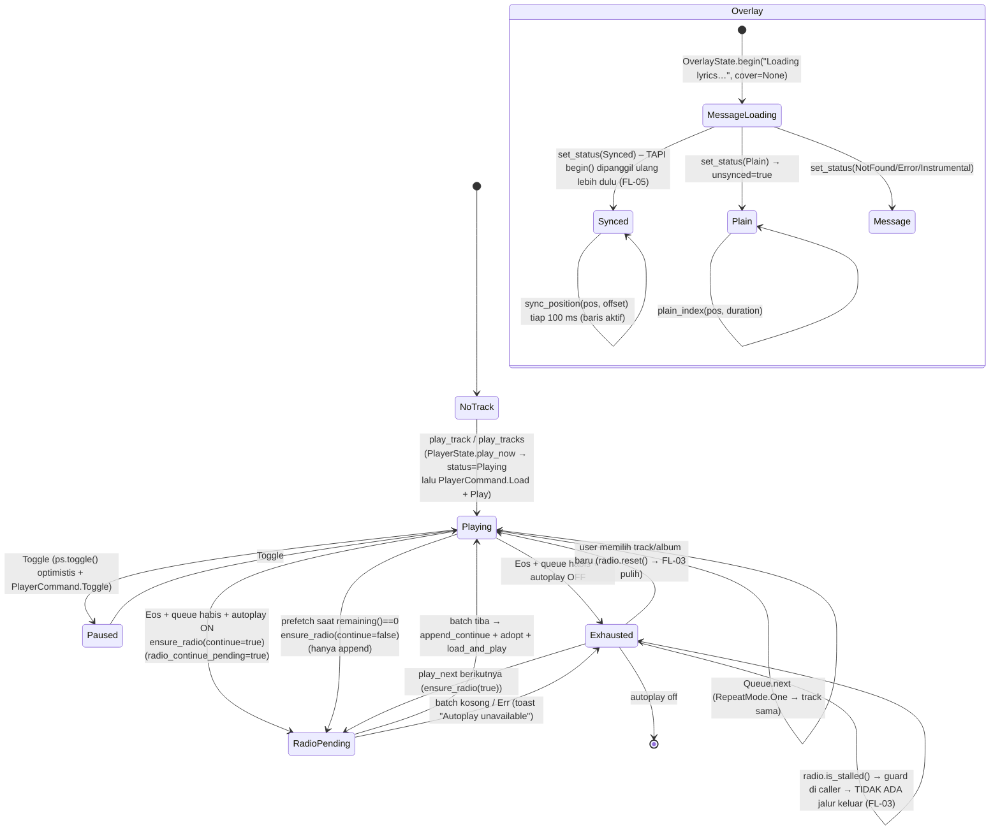

# Audit Flow Logic & State Machine — Myuzik

- **Repo / branch:** `/home/samvivan/Documents/Myuzik`, `master`, HEAD `e096e20` (working tree bersih saat audit).
- **Tanggal audit:** 2026-11-11.
- **Metode:** auditor statis (tanpa runtime GStreamer/Navidrome, tanpa `cargo build`, tanpa GUI/network). Evidence tier: **Auditor (bounded scope)** — graph MCP generasi `2026-11-10T18:27:42Z` (17 file scope + scope `src`/`tests`: `no_recorded_issue`, `metadata_match`), lalu **setiap klaim dibaca ulang baris-per-baris di sumber** (graph hanya dipakai untuk memastikan daftar pemanggil/ketiadaan pemanggil).
- **Alat:** `codebase-memory-mcp` (`index_status`, `get_architecture` hotspots, `trace_path` untuk `load_and_play`/`ensure_radio`, `query_graph` untuk pemanggil `Queue.play_now`, `check_index_coverage`), ditambah `grep`/`read` untuk nomor baris persis.
- **Aturan bukti:** kolom **Bukti** berisi `kode` = terbukti dari `file:line`; `kode+rt` = jalur kodenya terbukti tetapi dampak/urutan runtime (timing GStreamer, durasi blocking, perilaku DBus) perlu diverifikasi di mesin nyata.

## 1. Ringkasan eksekutif

| Severity | Jumlah | Inti masalah |
|---|---:|---|
| **P0** | 1 | `Shell` memegang `Mutex<Radio>` dari UI thread sementara thread background memegangnya selama sampai 7 HTTP blocking (`ureq`), jadi klik Play/lagu bisa membekukan seluruh UI sampai puluhan detik. |
| **P1** | 8 | Batch radio basi menimpa queue baru; autoplay mati permanen setelah stall; race cover (art & metadata MPRIS tertukar); overlay kehilangan cover saat lirik tiba; `open_album` tanpa generation guard (album salah / halaman kosong tanpa jalan kembali); error stream tidak punya state `Error`/retry/advance; repeat & shuffle tidak punya jalur UI sama sekali; `MPRIS Seek(offset)` diperlakukan sebagai posisi absolut. |
| **P2** | 13 (+1 sub-temuan FL-01b) | Scrobble: durasi basi + delta ≥2 s dibuang + gagal submit tanpa retry/rollback; `TrackStarted` optimistis; `PlaybackStatus::Error` tak pernah dibentuk; status gst menimpa status optimistis (dua mirror state); dead API `Shell::next/previous` yang mengirim `Stop`; `scrobble_submitted` duplikat mati; prefetch sia-sia di mode shuffle; `Previous` mati setelah queue habis; seek tanpa clamp/`Result` diabaikan; lifecycle engine tanpa shutdown; `expect()` di jalur error; duplikasi transisi `Route`; error fetch artist/playlist ditelan diam-diam. |

**Satu-satunya P0 adalah *hang* (UI freeze), bukan crash atau kehilangan data.** Semua jalur `panic!`/`expect()` yang ditemukan berada di cabang error yang jarang (FL-20). Total 22 temuan + 1 sub-temuan.

**Yang sudah benar dan penting untuk tidak "diperbaiki" sembarangan:** guard generasi untuk pencarian (`src/ui/shell.rs:2825-2839`) dan lirik (`src/ui/shell.rs:860-883`, `881-883`) ada dan diuji; dedup radio (`seen` + ring `recent`), urutan sumber radio, batas queue 500, dan clamp geometri overlay semuanya terjaga test (lihat §4).

## 2. Diagram alur state kritis

### 2.1 `play → queue → radio → overlay`



### 2.2 Rantai event pemutar (satu-satunya jalur state engine → UI)

```
GStreamer bus (thread pemutar, src/player/engine.rs:72-102)
  └─ send(PlayerEvent::{StateChanged|Position|Duration|Eos|Error|Buffering|TrackStarted})
        │  flume::unbounded (engine.rs:47-48)
        ▼
Shell event loop, cx.spawn (src/ui/shell.rs:230-401)
  ├─ StateChanged → PlayerState.set_status + NowPlayingView.set_playing + tray + MPRIS (:237-255)
  ├─ Position     → PlayerState.set_position, scrobble.tick (guard delta < 2 s) (:256-315)
  ├─ Duration     → track_duration = dur; PlayerState.duration (:316-323)
  ├─ Eos          → status=Stopped → Shell::play_next (:324-334)
  ├─ Error        → toast saja; status TIDAK diubah (:335-344)          ← FL-07
  └─ TrackStarted → scrobble.reset(), last_pos=0, MPRIS metadata (:345-381)
        ▼
load_and_play (src/ui/shell.rs:820-911)
  ├─ PlayerCommand::Load/Play (hanya jika client Some + stream_url Ok)
  ├─ cache_track_cover → async (tanpa generation)                      ← FL-04
  ├─ OverlayState.begin + set_cover(cached)
  ├─ lyrics fetch → guard lyrics_generation → np.set_track + os.begin + os.set_status  ← FL-05
  ├─ radio.note_played
  └─ jika autoplay && remaining()==0 → ensure_radio(false)
```

## 3. Tabel temuan

> Format skenario: langkah dipisah `<br>`; semua nomor baris merujuk HEAD `e096e20`.

### P0

| ID | Sev | File:line | Skenario reproduksi | Dampak | Rekomendasi | Bukti |
|---|---|---|---|---|---|---|
| **FL-01** | **P0** | `src/ui/shell.rs:966-968` (lock + `next_batch` di background), `src/ui/shell.rs:704-713`, `735`, `904-907` (lock di UI thread), `src/library/radio.rs:100-215`, `src/navidrome/client.rs:36,51-57` | 1) Mainkan satu lagu dengan autoplay ON (atau album sampai track terakhir) sehingga `ensure_radio` jalan.<br>2) Saat fetch radio masih berjalan, server lambat/menggantung.<br>3) Klik lagu lain atau tombol Next.<br>4) `play_track`/`play_tracks`/`load_and_play` memanggil `self.radio.lock()` di UI thread (`:710-713`, `:735`, `:904-907`) sementara task background (`:966-967`) masih memegang lock itu selama `next_batch` menjalankan sampai 7 request `ureq` blocking (`radio.rs:125,140,162,188`). | Seluruh UI membeku selama batch radio berjalan. Dengan timeout terpasang 8 s connect / 15 s recv / 25 s global per request (`client.rs:53-55`), worst case satu batch = 7 × 25 s ≈ **175 s** UI tidak merespons; user wajar mengira app hang lalu kill (queue/sesi hilang). | Jangan pegang `std::sync::Mutex<Radio>` selama I/O: ambil snapshot state paging (`last_seed`, `genre_offset`, `empty_batches`, `recent`) di UI thread, lepas lock, jalankan `next_batch` tanpa lock (atau pakai `Arc<Mutex<Radio>>` hanya untuk commit hasil), dan jangan pernah `lock()` dari UI thread saat `radio_in_flight == true`. Alternatif: `try_lock` di jalur UI + antrekan intent reset. | kode; durasi blocking nyata: rt |
| **FL-01b** | P2 | `src/ui/shell.rs:941-948` | Sama seperti FL-01 tetapi pada jalur `load_and_play → ensure_radio` yang juga `lock()` untuk `is_stalled()`. | Blokir singkat setiap pergantian track; tetap terblokir penuh bila batch sedang jalan. | Cek `is_stalled` dari cache `AtomicBool` yang diperbarui thread fetch, bukan dari mutex. | kode |

### P1

| ID | Sev | File:line | Skenario reproduksi | Dampak | Rekomendasi | Bukti |
|---|---|---|---|---|---|---|
| **FL-02** | P1 | `src/ui/shell.rs:723-737` (`play_tracks` hanya `radio.reset()`), `src/ui/shell.rs:961-1006` (tidak ada cek generasi/seed saat hasil tiba), `src/player/queue.rs:226-238`, `src/player/state.rs:64-70` | 1) Autoplay ON. Mainkan album A; biarkan track terakhir habis → `Eos` → `ensure_radio(true)` → `radio_continue_pending=true`, fetch A berjalan.<br>2) Sebelum fetch selesai, klik album B (`play_tracks` → `play_now` mengganti queue, `radio.reset()` — tetapi `radio_in_flight`/`radio_continue_pending` **tidak** direset).<br>3) Fetch A mendarat: `pending.swap(false)` = true → `queue.append_continue(batch_A)` + `ps.adopt` + `load_and_play` (`:978-991`). | Track dari seed album A langsung memutar menggantikan track pertama album B yang baru dipilih user; queue B juga tercemar 20 track genre A. Tanpa `pending`, batch A tetap masuk ke queue B (musik salah genre setelah album B selesai). Illegal transition: hasil async milik queue lama diterapkan ke queue baru. | Tambahkan token generasi queue (mis. `queue_generation: AtomicU64`, dinaikkan di `play_track`/`play_tracks`) ke `ensure_radio`; buang hasil bila generasi berubah. Reset `radio_in_flight`/`radio_continue_pending` saat queue diganti, dan ikat batch ke `seed.id` (tolak bila `ps.current.id != seed.id`). | kode |
| **FL-03** | P1 | `src/ui/shell.rs:919-948` (guard `is_stalled()` di caller), `src/library/radio.rs:71-73`, `107-114`, `206-213`, `src/library/radio.rs:278-287` (test), `tests/radio.rs:393-437` | 1) Library kecil sehingga 3 batch berturut-turut kosong (semua lagu sudah ada di queue/`recent`) → `empty_batches = 3`, `is_stalled()` true.<br>2) Playback lanjut ke track berikutnya di album yang sama (`load_and_play` → `ensure_radio`).<br>3) `ensure_radio` langsung `return` di `:943-947` **sebelum** `next_batch` dipanggil.<br>4) Karena `empty_batches` hanya bisa dinolkan di dalam `next_batch` (`radio.rs:107-111` reset saat seed berubah, `:212` saat batch berhasil), jalur pemulihan itu tidak pernah tercapai. | Autoplay mati untuk sisa queue/album itu, bahkan setelah server pulih atau seed berganti; satu-satunya jalan keluar adalah user memilih track/album baru (`play_track`/`play_tracks` memanggil `radio.reset()`). Bertentangan dengan komentar desain "stays quiet until a different track seeds it" (`radio.rs:69-70`) dan klaim `docs/progress.md` "stops after repeated empty batches". | Pindahkan guard ke dalam `next_batch` (setelah blok reset-per-seed), atau di `ensure_radio` reset `empty_batches` bila `seed.id != radio.last_seed()`. Tambah test level `Shell`: stall → seed baru → batch diambil lagi. | kode (test `the_radio_stalls_after_repeated_empty_batches_and_recovers_on_a_new_seed` hanya membuktikan pemulihan di level `Radio`, bukan lewat `Shell`) |
| **FL-04** | P1 | `src/ui/shell.rs:760-818` (tanpa generation), `799-811` (`set_cover` global), `812-814` (MPRIS metadata), bandingkan guard lirik `:860-883` | 1) Mainkan track A yang cover-nya belum di cache (`cache_track_cover` mulai fetch A).<br>2) Sebelum fetch A selesai, klik track B (cover B juga di-fetch).<br>3) Fetch A selesai belakangan: `insert_cover(A)` (aman, keyed) tetapi juga `np.set_cover(Some(A))`, `overlay.set_cover(A)`, dan `mh.update_metadata(&track_A, art_A)` — semuanya tanpa membandingkan track aktif. | Now Playing & overlay menampilkan cover lagu A sementara yang berbunyi B; metadata MPRIS/notifikasi desktop menampilkan judul/art A untuk lagu B sampai track berikutnya. Race yang sama kelasnya sudah dicegah untuk lirik (generation) tetapi tidak untuk cover. | Beri `cover_generation` (`AtomicU64`) seperti `lyrics_generation`: naikkan di `load_and_play`, simpan nilainya, dan di completion hanya terapkan bila masih generasi terakhir **dan** `ps.current.id == track.id`. `insert_cover` boleh tetap jalan (cache keyed), tetapi `np/overlay/mpris` harus di-guard. | kode |
| **FL-05** | P1 | `src/overlay/mod.rs:197-206` (`begin` mengosongkan `cover`, `duration`, `position`), `src/ui/shell.rs:891-894` (`begin` dipanggil ulang saat lirik tiba), `:843-847`, `:856-859`, `:887` | 1) Mainkan track yang cover-nya **sudah** ada di `HomeState.covers` (mis. track kedua album yang sama).<br>2) `load_and_play` → `st.begin()` (cover=None) → `st.set_cover(cached)` → overlay benar menampilkan art.<br>3) Fetch lirik selesai → callback di `:891-893` memanggil `st.begin(...)` lagi → `cover` kembali `None` (tidak ada yang mengisinya lagi karena `cache_track_cover` sudah early-return untuk cover yang ter-cache, `:764-766`). | Cover di jendela pin hilang setiap kali lirik selesai dimuat — deterministik untuk track yang cover-nya ter-cache, dan probabilistik (tergantung urutan jaringan) untuk yang belum. `position`/`duration` overlay juga di-reset ke 0/None sampai tick berikutnya. | Jangan panggil `begin()` pada kedatangan lirik: panggil `st.set_status(&status)` saja (`:893` sudah ada). Bila memang perlu update judul, buat `OverlayState::set_track()` yang tidak menyentuh `cover`. Tambahkan test overlay: set cover → set_status → cover tetap ada. | kode |
| **FL-06** | P1 | `src/ui/shell.rs:1188-1245` (`open_album`), `:2660-2664` (header disembunyikan bila `selected_album.is_some()`), `:3328` (pane album butuh `album_detail`), `:1247-1266` (`select_artist`), `:1268-1287` (`play_playlist`) | 1) Klik album A, lalu cepat klik album B (dua fetch paralel, **tanpa** token generasi — bandingkan `search_generation` di `:2825-2839`).<br>2) Respons A tiba belakangan → `album_detail = A` sementara `selected_album = B`.<br>3) Varian error: server membalas 500 untuk album → `album_detail` tetap `None`, `album_loading=false`.<br>4) Header halaman sudah disembunyikan karena `selected_album.is_some()`, dan tombol "album-back"/"Play all" hanya ada di dalam cabang `album_detail` → tidak ada jalan kembali selain sidebar. | (a) User melihat album A padahal mengklik B (state UI vs pilihan user tidak konsisten); (b) pada error, area konten kosong tanpa pesan dan tanpa tombol kembali = layar buntu. `select_artist` sejenis: error diabaikan sehingga halaman artist lama tetap tampil; `play_playlist` error = tombol terasa mati. | Tambah `album_generation`/`artist_generation` (`AtomicU64`) + simpan `selected_album` saat spawn lalu bandingkan saat hasil tiba; tambahkan state `album_error: Option<String>` yang dirender dengan tombol "Back" independen dari `album_detail`; tampilkan toast untuk `play_playlist` yang gagal. | kode |
| **FL-07** | P1 | `src/ui/shell.rs:335-344` (Error → toast saja), `src/player/state.rs:38-48` (status `Playing` diset optimistis), `src/player/state.rs:5-12` (`PlaybackStatus::Error` tidak pernah dibentuk — grep seluruh `src/`), `src/player/engine.rs:79-83` | 1) Mainkan lagu dari server yang putus di tengah stream (Wi-Fi mati / server restart).<br>2) GStreamer memposting `Error` → event loop hanya `tracing::error!` + `toast`.<br>3) Status tetap `Playing` (tidak ada `set_status(Error)`), tidak ada `player_state.next()`, tidak ada retry/backoff, `scrobble` tetap "berjalan". | UI menyatakan sedang memutar padahal senyap; tidak ada auto-advance ke track berikut, tidak ada retry setelah jaringan kembali; satu-satunya pemulihan adalah interaksi manual (Next/klik lagu) — dan `PlaybackStatus::Error` yang tersedia di enum tidak pernah dipakai sehingga UI/MPRIS tidak punya cara menampilkan status error (MPRIS memetakan `_ => Stopped`, `src/platform/mpris.rs:101-108`). | Pada `PlayerEvent::Error`: `ps.set_status(PlaybackStatus::Error)` + `scrobble.reset()`; retry N kali dengan backoff untuk `Load` yang gagal, lalu auto-advance ke track berikutnya (dengan guard agar tidak loop pada queue yang seluruhnya mati); expose `Error` di UI (ikon/toast persisten) dan MPRIS. | kode |
| **FL-08** | P1 | `src/player/queue.rs:157-169` (`set_repeat`/`set_shuffle`), `src/player/state.rs:102-108`, **tidak ada pemanggil** di `src/` (grep `set_repeat\|set_shuffle` → hanya definisi; `codebase-memory` `search_graph`/`grep` sama), klaim di `docs/progress.md` ("Task 12: Queue, shuffle, repeat, next/previous, EOS auto-advance") dan `docs/acceptance.md:74` | 1) Jalankan aplikasi, buka Settings dan player bar.<br>2) Cari kontrol repeat/shuffle: tidak ada tombol, tidak ada shortcut, tidak ada field config.<br>3) Akibatnya `Queue::shuffle`/`RepeatMode` hanya bisa masuk lewat test (`tests/queue.rs`) atau API publik. | Fitur yang diklaim selesai & "wired" tidak dapat diaktifkan user; seluruh jalur kode shuffle/repeat (termasuk `rebuild_shuffle`, `trim_front_to` shuffle, interaksi dengan autoplay FL-16) tidak pernah dieksekusi di produksi, sehingga bug di dalamnya tidak terlihat. | Tambahkan kontrol UI (player bar / Settings) + shortcut, atau turunkan klaim di `docs/progress.md`/`docs/acceptance.md` menjadi "queue-level only, UI belum ada". Bila diaktifkan, selesaikan dulu FL-16. | kode |
| **FL-09** | P1 | `src/platform/mpris.rs:72-76` (`connect_seek`), `:83-87` (`connect_set_position`, benar), `src/player/engine.rs:163-168`, `~/.cargo/registry/.../mpris-server-0.11.0/src/player.rs:200,570` (`async fn seek(&self, offset: Time)` — offset relatif) | 1) Hubungkan client MPRIS (mis. `playerctl`/panel) yang memanggil `Seek(+10s)` pada posisi 120 s.<br>2) Handler mengubah offset menjadi `Duration::from_micros(...)` dan mengirim `PlayerCommand::Seek(pos)`.<br>3) Engine memanggil `seek_simple` ke posisi itu sebagai **absolut** → playback melompat ke 10 s.<br>4) `Seek(-5s)`: `time.as_micros()` bertipe `i64`; cast `as u64` pada nilai negatif menghasilkan angka sangat besar → `ClockTime::from_nseconds(pos.as_nanos() as u64)` (`engine.rs:166`) terpotong modulo 2^64 → posisi acak/EOS. | Seek dari client MPRIS berperilaku salah (lompat ke offset, bukan menambah), dan seek mundur dapat mengakhiri track (tersangka penyebab "lagu tiba-tiba ganti saat seek dari panel"). `SetPosition` absolut tetap benar. | Hitung posisi absolut dari `PlayerState.position` di handler `connect_seek` (butuh akses state; kirim `PlayerCommand::SeekBy(i64)` dan resolve di sisi UI/event loop tempat `position` diketahui), atau minimal pakai `saturating_add_signed`. Tambah unit test untuk offset positif & negatif. | kode; perilaku client nyata: rt |

### P2

| ID | Sev | File:line | Skenario reproduksi | Dampak | Rekomendasi | Bukti |
|---|---|---|---|---|---|---|
| **FL-10** | P2 | `src/player/engine.rs:143-148`, `src/ui/shell.rs:345-381` | 1) Mainkan lagu yang URL stream-nya 404/401 (mis. kredensial kedaluwarsa).<br>2) `Load` menyetel `uri` lalu **langsung** mengirim `TrackStarted` tanpa menunggu preroll/`Error`.<br>3) Shell mengirim scrobble "now playing" (`:375-379`) dan memulai fetch lirik/cover. | Server mencatat "now playing" untuk lagu yang tidak pernah diputar; fetch lirik/cover boros; `scrobble_track` menunjuk lagu yang tidak berbunyi sehingga bila `Position` basi masih mengalir, waktu dengar tercatat untuk lagu salah. | Kirim `TrackStarted` setelah state gst mencapai `PAUSED`/`PLAYING` (atau setelah `prepare` AsyncDone), atau tambahkan flag `confirmed` yang baru diisi saat state pertama `Playing` tiba; tunda scrobble now-playing sampai itu. | kode; urutan pesan gst: rt |
| **FL-11** | P2 | `src/ui/shell.rs:231-234` (`track_duration` loop-local), `:265-285` (guard `delta < 2 s`), `:316-322` (Duration tanpa reset di TrackStarted), `:345-349`, `src/player/scrobble.rs:32-44` | 1) Putar lagu 10 menit (threshold 240 s) lalu lagu 3 menit: `TrackStarted` **tidak** mereset `track_duration` (`:347-349` hanya `scrobble.reset()` + `last_pos`), sehingga tick awal lagu baru memakai durasi lagu lama.<br>2) Bila UI/main loop sempat tersendat (render berat, blocking FL-01) sehingga jarak dua `Position` ≥ 2 s, delta itu dibuang seluruhnya (`:268`).<br>3) Bila POST scrobble gagal (offline), `let _ = client.scrobble(...)` (`:282`, `:377`) diabaikan dan `ScrobbleTracker.submitted` sudah `true` di memori. | Threshold dihitung dari durasi track sebelumnya pada jendela awal; waktu dengar bisa kurang dari yang sebenarnya (track tidak ter-scrobble walau didengar penuh saat sistem lambat); kegagalan submit tidak pernah di-retry dan tidak ada rollback `submitted`, jadi scrobble hilang permanen tanpa jejak. | Reset `track_duration` di `TrackStarted`; hitung delta dari selisih monotonic clock yang dipisahkan dari gap render (atau akumulasi `Position` yang lebih kecil, simpan `last_pos` hanya saat delta wajar dan catat `delta > 2 s` sebagai "seek/suspend"); pada kegagalan submit, reset `submitted=false` dan (opsional) masukkan ke antrean retry. Tambah test integrasi scrobble di level `Shell` (belum ada). | kode |
| **FL-12** | P2 | `src/player/state.rs:5-12`, `src/player/engine.rs:84-93`, `:95-97`, `src/ui/shell.rs:382-384` | 1) Putar stream lambat.<br>2) gst memposting `Buffering(p)` → shell hanya `tracing::debug!`.<br>3) `PlaybackStatus::Buffering` hanya muncul dari fallback `_ =>` pada `StateChanged` (state gst yang tidak dipetakan), bukan dari pesan buffering; `PlaybackStatus::Error` tidak pernah dibentuk. | Tidak ada indikator buffering sama sekali (spinner/status) — user melihat tombol Pause & posisi diam tanpa penjelasan; state `Error` tidak dapat direpresentasikan. | Petakan `PlayerEvent::Buffering(p)` → `PlaybackStatus::Buffering` bila `p < 100` dan render indikator; buat `set_status(Error)` dari jalur error (lihat FL-07). | kode |
| **FL-13** | P2 | `src/player/engine.rs:84-93`, `src/ui/shell.rs:237-255`, `:2013-2016`, `:2290-2293`, `src/player/state.rs:82-88` | 1) Mulai lagu baru; `PlayerState::play_now` sudah menyetel `status=Playing` (optimistis).<br>2) `Load` → `set_state(Ready)` → gst memposting `StateChanged(Ready→Stopped)`; handler `:237-255` menimpanya menjadi `Stopped` lalu `Playing` ketika preroll selesai.<br>3) Pada jendela itu, UI memakai `status` (`:1735`) → ikon berkedip stop/play; `ps.toggle()` (`state.rs:82-88`) mengabaikan `Stopped`, sedangkan engine `Toggle` (`engine.rs:155-162`) tetap menyetel `Playing` → dua sumber kebenaran berbeda. | Icon/teks status bisa tidak sesuai isi audio selama transisi; setelah `Error` (FL-07) status tidak pernah kembali konsisten. Tiga mirror state (`PlayerState.status`, `NowPlayingView.playing`, state tray, MPRIS) diperbarui di tempat berbeda. | Satu sumber kebenaran: jangan set status optimistis; atau tandai `pending_load` dan abaikan `StateChanged(Stopped)` selama load. Perluas `PlayerState::toggle` untuk `Buffering`/`Error`. Turunkan `NowPlayingView.playing` menjadi turunan `PlayerState.status`. | kode; kedipan nyata: rt |
| **FL-14** | P2 | `src/ui/shell.rs:475-489` | 1) `Shell::next()`/`previous()` (API publik) mengirim `PlayerCommand::Stop`, bukan `Next`/`Previous`.<br>2) Tidak ada pemanggil di `src/` maupun `tests/` (grep), tetapi ini API publik yang tampak seperti "next track". | Jebakan laten: pemanggil baru (tray/menu/extension di masa depan) akan menghentikan playback alih-alih pindah track. `play`/`pause`/`seek`/`set_volume` di struct yang sama juga tidak dipakai (UI mengirim `PlayerCommand` langsung, `now_playing.rs:255,314`). | Hapus atau arahkan ke `self.play_next(cx)`/`play_previous(cx)` (butuh `Context`), dan dokumentasikan bahwa transport UI memakai `PlayerCommand` langsung. | kode |
| **FL-15** | P2 | `src/player/state.rs:22`, `:47`, `:57`, `:69`, `:78` | Field `scrobble_submitted` hanya ditulis, tidak pernah dibaca (grep seluruh `src/`); tracker sebenarnya adalah `ScrobbleTracker` lokal di event loop (`shell.rs:231`). | Dua representasi "sudah scrobble" yang bisa menyimpang; pembaca berikutnya mudah salah memakainya. | Hapus field dari `PlayerState` (dan dari konstruktor/reset), atau jadikan satu-satunya sumber dengan memindahkan tracker ke `PlayerState`. | kode |
| **FL-16** | P2 | `src/player/queue.rs:216-220` (`append` tidak menyentuh `shuffle_order`), `:99-115` (`next` hanya lewat `shuffle_order`), `:226-238` (hanya `append_continue` rebuild), `src/ui/shell.rs:992-996` | 1) Aktifkan shuffle (belum ada UI — lihat FL-08; untuk repro pakai API).<br>2) Mainkan queue 10 lagu; prefetch autoplay terpicu saat `remaining()==0` → `queue.append(20 lagu)` tanpa `rebuild_shuffle`.<br>3) Putaran shuffle berakhir (`shuffle_pos == shuffle_order.len()`), `RepeatMode::Off` → `current=None`, `next()` → `None` → `Eos` → `play_next` → `ensure_radio(true)` → jeda jaringan, baru `append_continue` me-rebuild. | Klaim "Prefetches before the queue runs dry so there is no gap" (`docs/progress.md`) tidak berlaku saat shuffle: 20 track prefetch tidak pernah diputar pada putaran itu (indeksnya tidak ada di `shuffle_order`), dan tiap akhir putaran menghasilkan jeda + satu request radio tambahan. Laten selama shuffle belum punya UI. | Di `append`: bila `self.shuffle`, rebuild order dengan mempertahankan posisi (`shuffle_order` lama + indeks baru diacak dan disisipkan setelah `shuffle_pos`). Tambah test: `append` saat shuffle → semua track baru dapat diputar pada putaran berjalan. | kode |
| **FL-17** | P2 | `src/player/queue.rs:131-155` (`previous`), `src/ui/shell.rs:753-758` | 1) Biarkan queue habis dengan autoplay OFF sampai `Eos` (`queue.current == None`, `PlayerState.current` masih track terakhir).<br>2) Tekan tombol Previous / Shift+Left / tray Previous.<br>3) `queue.previous()` jatuh ke `self.current.map(...)` = `None` → `play_previous` tidak melakukan apa pun. | Tombol Previous terasa mati tepat pada kondisi yang paling wajar untuk memakainya (mengulang lagu terakhir). Queue juga tidak "bangun" kembali karena `current` tetap `None`. | Bila `items` tidak kosong dan `current == None`: set `current = Some(len-1)` (atau indeks shuffle terakhir) dan kembalikan track itu; tambahkan test `previous_after_exhaustion_restarts_last_track`. | kode |
| **FL-18** | P2 | `src/ui/shell.rs:2069-2073` (`+10 s`), `:1935-1939` (`−10 s`, `saturating_sub` aman), `:2304-2311` (`→ +5 s`), `src/player/engine.rs:163-168` | 1) Putar lagu dan tekan `+10` beberapa kali hingga melewati durasi (tidak ada clamp ke `state.duration`).<br>2) gst `seek_simple` ke posisi > durasi → biasanya `Eos` → track berganti.<br>3) Varian: tekan seek tepat setelah klik lagu (sebelum preroll) → `seek_simple` mengembalikan `Err`, `let _ =` membuangnya (`engine.rs:164`). | "Seek forward" di dekat akhir lagu tidak "maju ke akhir" tetapi mengganti track (mengejutkan); seek yang gagal hilang tanpa umpan balik sehingga tombol terasa tidak berfungsi. `Result` seek tidak pernah dilaporkan. | Clamp ke `duration.saturating_sub(1 s)` bila `duration` diketahui (state sudah punya `duration`, `:316-322`), dan kirim balik `PlayerEvent::Error`/log saat `seek_simple` gagal. | kode; perilaku gst: rt |
| **FL-19** | P2 | `src/player/engine.rs:46-66`, `:104-129`, `:176-181`, `:47-48` | 1) Amati lifecycle: tidak ada `Drop`/`quit` untuk thread pemutar; `main_loop.run()` tidak pernah di-`quit()` (komentar "cleanup" di `:127-128` tidak tercapai).<br>2) Bila `gst::init` gagal (`:51-56`) thread `return` sebelum loop; `PlayerHandle.tx` tetap hidup dan tidak ada yang menguras `cmd_rx` → perintah menumpuk di channel unbounded.<br>3) Bila shell/event loop mati, `evt_tx` tetap dipegang bus watch + tick → `recv_async` tidak pernah `Err` (loop tidak pernah `break`). | Tidak ada shutdown rapi (pipeline tidak di-Null saat keluar normal), kebocoran task/thread sampai proses exit, dan potensi pertumbuhan memori bila konsumen berhenti (channel `unbounded`). Risiko tambahan: `timeout_add_local`/`MainLoop::new(None, _)` memakai **default GLib main context global** dari thread non-main; aman hanya selama tidak ada komponen lain yang menjalankan context yang sama (GLib akan assert "main context is already owned"). | Tambahkan `PlayerCommand::Shutdown` + `main_loop.quit()` + `JoinHandle`; pakai `flume::bounded` untuk `PlayerEvent`/`PlayerCommand`; panggil `MainContext::new()`/`with_thread_default` agar tidak memakai context global. | kode; konflik context GLib: rt |
| **FL-20** | P2 | `src/overlay/mod.rs:1000-1003` (`expect("failed to open overlay window")`), `src/ui/shell.rs:184-193` (`.expect("client already validated")`), `:1069-1072` (`.expect("validated client")`) | 1) Tekan Ctrl+P di kompositor yang menolak window baru (batas window/layar) → `cx.open_window(...).expect(...)` panic di UI thread.<br>2) Varian startup: `load_password` di `:176` berhasil membentuk `client`, lalu `load_password` kedua di `:185` mengembalikan `None` (keyring race/file dihapus) → `.expect` panic saat `Shell::new`, bukan jatuh ke `Route::Setup`. | Crash (panic) alih-alih pesan error; pada kasus startup, aplikasi tidak bisa dibuka sama sekali tanpa indikasi penyebab. | Ganti `expect` dengan jalur error: `open_overlay` mengembalikan `Option`/`Result` dan menampilkan toast; `Shell::new` memakai `match` dan fallback ke `Route::Setup` bila client tidak bisa dibuat ulang. | kode (probabilitas kejadian: rt) |
| **FL-21** | P2 | `src/app.rs:8-21` (`Route::Album/Artist/Playlist`), `src/ui/shell.rs:1317-1319` (`go()`), `:2593-2600`, `:2792`, `:2323`, `:3131`, `:2750` | 1) Navigasi dilakukan dengan assignment langsung (`this.route = Route::X`) di >10 tempat, bukan lewat `go()`.<br>2) `Shell::go` hanya dipanggil test (`tests/ui_shell.rs:52,69`, `tests/a11y.rs:350`, `tests/screenshots.rs`).<br>3) `Route::Album(_)`/`Artist(_)`/`Playlist(_)` tidak pernah dikonstruksi di `src/` (grep) — detail album ditampilkan lewat kombinasi `route == Home && selected_album.is_some()`. | Transisi route tidak punya satu titik yang bisa menjamin cleanup (mis. membatalkan fetch album, clear `search_results`, reset `album_loading`); test yang memakai `go()` menguji jalur yang tidak sama dengan jalur produksi. Tiga varian `Route` mati. | Jadikan `go()` satu-satunya transisi (pindahkan cleanup + invalidasi generasi ke sana) dan pakai `Route::Album(id)` sebagai sumber kebenaran, atau hapus varian yang tidak dipakai. | kode |
| **FL-22** | P2 | `src/ui/shell.rs:1247-1266` (`select_artist`), `:1268-1287` (`play_playlist`), `:1289-1315` (`toggle_album_star`), `:1188-1245` | 1) Dengan server yang membalas 500 untuk `getArtist`, klik artist → `if let Ok(d)` gagal, tidak ada toast, `artist_detail` lama tetap tampil.<br>2) Klik playlist saat server mati → `play_tracks` tidak dipanggil, tidak ada pesan; tombol tampak rusak.<br>3) `toggle_album_star` hanya memperbarui UI saat `res.is_ok()` dan tanpa pesan gagal. | Kegagalan operasi user tidak terlihat (silent failure) dan UI bisa menampilkan data lama sebagai jika request baru berhasil — bertentangan dengan pola toast yang sudah dipakai di jalur lain (`spawn_home_fetch` `:3727-3742`, radio `:1000-1004`). | Tambahkan toast/`error` state yang seragam untuk semua fetch library (satu helper `report_error`), dan reset data lama (`artist_detail = None`) saat memulai fetch. | kode |

## 4. Invariant: dijaga test vs tanpa test

### 4.1 Sudah dikunci test (jangan dilaporkan sebagai bug)

| Invariant | Test |
|---|---|
| `Queue`: next/repeat off/one/all, wrap, previous, shuffle mengunjungi semua track, `play_next` insert, `add_to_queue`, 100× next/prev konsisten | `tests/queue.rs` (16 test) |
| `remaining()`, `append` tidak menggeser `current`, `append_continue` melanjutkan setelah habis, no-op batch kosong, `trim_front_to` menjaga `current`, trim di shuffle tetap valid, `ids()` untuk dedup | `tests/queue.rs` |
| Autoplay: satu track → queue bertambah & berlanjut setelah `Eos`; autoplay off → berhenti di track terakhir & tidak ada request radio; radio gagal total → satu toast, queue tidak berubah | `tests/autoplay_flow.rs` (`playing_one_track_queues_similar_music_and_continues`, `autoplay_off_stops_at_the_end_of_the_queue`, `a_failing_radio_shows_one_toast_and_leaves_the_queue_alone`) |
| Radio: urutan sumber, dedup (queue/recent/seed), paging genre & wrap, short page reset, random backstop, satu sumber gagal tidak menggagalkan batch, semua gagal → satu `Err`, stall setelah 3 batch kosong & pulih via seed baru (level `Radio`) | `tests/radio.rs` (9 test) |
| Pencarian out-of-order dibuang (guard generasi) | `tests/stress.rs` (`stale_out_of_order_search_responses_are_discarded`, `two_hundred_searches_keep_only_the_newest_result`), `tests/ui_flow.rs` (`stale_search_response_is_discarded`) |
| Respons lirik basi dibuang | `tests/ui_flow.rs` (`stale_lyrics_response_is_discarded`) |
| Overlay: band bukan seluruh lagu, offset lirik, pesan saat lirik tidak ada, repaint tanpa input, close menghapus window | `tests/overlay_lyrics.rs`, `tests/screenshot_overlay.rs` |
| Navigasi ke Artists membersihkan `album_detail` | `tests/ui_flow.rs` (`navigating_to_artists_clears_album_detail`) |
| Alur play dari home/playlist/artist/search & perintah `Load`/`Seek`/`Toggle` yang dikirim UI | `tests/ui_flow.rs` (`home_album_track_play_flow`, `playlist_click_plays_tracks`, `artist_click_shows_albums`, `global_shortcuts_work`) |
| Queue 20k track: churn next/prev, shuffle mengunjungi semua, repeat wrap, `PlayerState` sinkron | `tests/stress.rs` (`twenty_thousand_track_queue_survives_rapid_churn`) |
| Cache cover LRU 200 entri | `tests/cover_lru.rs`, `tests/stress.rs` (`five_hundred_cover_inserts_stay_bounded_and_lru`) |
| Threshold scrobble murni (50%/4 menit/min 30 s, sekali submit) | `src/player/scrobble.rs:66-123` (6 unit test) |
| Fokus keyboard/aria | `tests/a11y.rs` |

### 4.2 Tanpa test (celah yang harus ditutup)

| Invariant yang seharusnya ada | Status di kode | Temuan terkait |
|---|---|---|
| Hasil radio milik queue/seed lama tidak boleh masuk ke queue baru | **tidak ada guard**, **tidak ada test** | FL-02 |
| Pemulihan stall radio **lewat `Shell`** (bukan hanya level `Radio`) | guard caller membalik logika; test hanya level `Radio` | FL-03 |
| Respons cover out-of-order tidak boleh menimpa art/metadata track aktif | tidak ada guard, tidak ada test | FL-04 |
| Cover overlay bertahan setelah status lirik tiba | tidak ada test; perilaku berlawanan terbukti di kode | FL-05 |
| `open_album`/`select_artist`/`play_playlist`: respons basi & jalur error (UI tidak boleh kosong/buntu) | tidak ada guard, tidak ada test | FL-06, FL-22 |
| `PlayerEvent::Error`: state, retry/backoff, auto-advance | tidak ada test; `PlaybackStatus::Error` mati | FL-07 |
| Repeat/shuffle dapat diaktifkan dari UI | tidak ada kontrol, tidak ada test | FL-08 |
| Semantik `MPRIS Seek(offset)` (positif & negatif) | hanya metadata/posisi diuji (`tests/mpris_metadata.rs`) | FL-09 |
| `TrackStarted` hanya setelah track benar-benar siap / "now playing" tidak dikirim untuk load gagal | tidak ada test | FL-10 |
| Integrasi scrobble di `Shell`: reset `track_duration`, aturan delta, retry saat gagal | hanya unit test tracker murni | FL-11 |
| Status `Buffering`/`Error` dapat direpresentasikan dan ditampilkan | tidak ada | FL-12, FL-13 |
| `queue.append` saat shuffle ikut memperluas `shuffle_order` | tidak ada test (trim di shuffle ada) | FL-16 |
| `previous()` setelah queue habis memulai ulang track terakhir | tidak ada test | FL-17 |
| Seek melewati durasi / seek sebelum siap | tidak ada test | FL-18 |
| Satu titik transisi `Route` (`go()`) | test memakai `go()`, produksi tidak — jadi test tidak mewakili produksi | FL-21 |
| UI thread tidak pernah memblokir pada lock radio / I/O | tidak ada test | FL-01 |

## 5. Klaim dokumen vs kode

| Klaim | Lokasi | Status |
|---|---|---|
| "Task 12: Queue, shuffle, repeat, next/previous, EOS auto-advance" (wired) | `docs/progress.md` | **sebagian usang**: queue & next/prev wired; **shuffle/repeat tidak punya jalur UI** (FL-08) |
| "Queue: next/previous/repeat/shuffle, rapid 100× next/prev — tests/queue.rs (8 tests)" | `docs/acceptance.md:74` | **benar untuk level queue**, menyesatkan bila dibaca sebagai fitur aplikasi; jumlah test kini 16 |
| "Prefetches before the queue runs dry so there is no gap" | `docs/progress.md` §Post-0.1.0 | **benar hanya tanpa shuffle** (FL-16) |
| "stops after repeated empty batches instead of hammering the server" | `docs/progress.md`, `tests/radio.rs:421-429` | benar (tidak hammering) tetapi **pemulihan tidak terjangkau dari aplikasi** (FL-03); `docs/acceptance.md:119` menyebut "recovers on a new seed" yang di aplikasi hanya terjadi lewat queue baru |
| "Scrobble now-playing + submission at threshold — 6 tests" | `docs/acceptance.md:155` | hanya **tracker murni**; integrasi (`Shell`) tidak diuji dan punya tiga celah (FL-10, FL-11) |
| "20 000-track queue ... shuffle visits all 20k exactly once" | `docs/performance.md:110` | benar di level `Queue`; tidak membuktikan fitur shuffle dapat dipakai user (FL-08) |
| "GStreamer player thread + state machine (wired)" | `docs/progress.md` Task 11 | wired, tetapi state `Error`/`Buffering` tidak pernah dipakai (FL-07, FL-12) dan tidak ada shutdown (FL-19) |
| "MPRIS (metadata, status, next/prev, seek, volume)" | `docs/progress.md` Task 14 | metadata/status/next/prev benar; **seek relatif salah** (FL-09) |

## 6. Tidak diverifikasi (tanpa runtime GStreamer/Navidrome nyata)

1. **Urutan & duplikasi pesan bus GStreamer** (transient `Stopped`/`Paused` saat `Load`, `Buffering`, `Error` setelah preroll) — FL-10/FL-12/FL-13 disimpulkan dari kode + semantik gst, bukan dari log nyata.
2. **Durasi nyata UI freeze** pada FL-01 (tergantung latensi server; batas atas dari timeout `client.rs:51-57`).
3. **Apakah `seek_simple` benar-benar gagal** saat dipanggil sebelum preroll, dan apakah seek > durasi memicu `Eos` (FL-18).
4. **Perilaku `MainLoop::new(None, _)` + `timeout_add_local` di thread pemutar** terhadap context GLib global — aman atau assert, tergantung komponen lain di proses (FL-19).
5. **Perilaku client MPRIS nyata** (`Seek` negatif, `SetPosition`) di panel/desktop sungguhan — hanya dibaca dari signature `mpris-server-0.11.0` (FL-09).
6. **Kemungkinan panic** `cx.open_window` (FL-20) pada kompositor ini — tidak diuji.
7. **Urutan balapan jaringan** untuk cover/lirik/album (FL-04/FL-05/FL-06): kode membuktikan *tidak ada guard*; urutan mana yang menang bergantung latensi.
8. **Test live** (`tests/live_navidrome.rs`, `tests/live_player.rs`) `#[ignore]` — tidak dijalankan; semua klaim radio/playback nyata tidak diverifikasi di sini.
9. **Threading/`zbus`/tray** tidak diperiksa (milik audit integrasi), dan **biaya render/CPU** tidak diukur (milik audit performa).
10. Tidak ada `cargo build`/`cargo test`/GUI/network yang dijalankan selama audit ini, sesuai batasan tugas.

## 7. Yang sudah baik (jangan diubah tanpa alasan)

- Guard generasi lirik (`shell.rs:860-883`) dan pencarian (`shell.rs:2825-2839`) adalah pola yang benar — FL-04/FL-06 cukup menyalin pola ini.
- `radio_in_flight` + `radio_continue_pending` mencegah stampede fetch (satu fetch per batch) dan menangani kasus "fetch tiba setelah track habis" — invariant ini dikunci test (`append_continue_*`, `playing_one_track_queues_similar_music_and_continues`).
- `Queue` punya batas keras 500 (`MAX_QUEUE`), `trim_front_to` hanya membuang yang sudah diputar, dan dedup radio memakai `seen` + ring `RECENT_CAP=100`.
- `OverlayState` adalah state machine murni tanpa I/O (mudah diuji): `Message`/`Synced`/`Plain`, `band_range` menahan jumlah baris, dan ada ticker pengaman repaint (`overlay/mod.rs:516-560`).
- `on_window_closed` di `shell.rs:126-148` sudah menangani panic "already being updated" dengan `app.defer` — pola yang sama bisa dipakai untuk transisi lain.
- Test suite rapat untuk jalur yang memang diklaim: 16 test queue, 9 radio, 3 autoplay end-to-end, plus stress 20k track — kesenjangan utamanya ada di **integrasi UI↔async** (FL-02, FL-04, FL-05, FL-06) yang memang tidak disentuh test mana pun.
